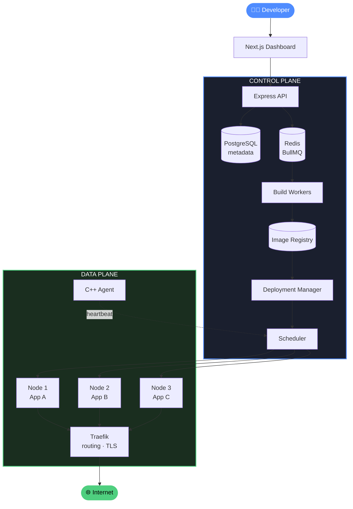
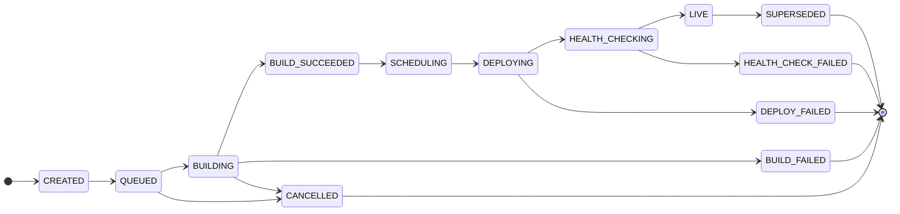

<div align="center">

<br />

# ⚒️ FORGE

### The Infrastructure Layer for Shipping Software

<p>
<em>Ship code, not infrastructure. From <code>git push</code> to a live, production-grade URL.</em>
</p>

<br />

[](./LICENSE)
[](#-roadmap)
[](https://github.com/Sachinn-64/Forge/actions)

<br />


<br />

**[Architecture](#-architecture)** · **[Modules](#-core-modules)** · **[Roadmap](#-roadmap)** · **[Getting Started](#-getting-started)** · **[Guides](./docs/guides/)**

<br />

</div>

---

<br />

Forge is a self-hosted, production-grade **Platform-as-a-Service**. Connect a GitHub repository, pick a branch, set your environment variables, and deploy. Forge builds the Docker image, schedules it onto a node, runs it in an isolated container, routes traffic to it with automatic HTTPS, and lets you roll back to any previous version in one click.

Inspired by **Vercel**, **Render** and **Railway**, but the point of this project is the infrastructure underneath: the build engine, the deployment state machine, the scheduler, the container runtime, and the reliability guarantees that hold it all together.

<br />

## ✨ Features

<table>
<tr>
<td width="33%" valign="top">

### 🚀 Git to Production
Push to a branch or click deploy. Forge clones, builds, ships and routes. Every deployment is pinned to an immutable commit SHA.

</td>
<td width="33%" valign="top">

### 🔄 Zero-Downtime Deploys
New version starts beside the old one. Traffic switches only after health checks pass. Old connections drain, then terminate.

</td>
<td width="33%" valign="top">

### ⏪ One-Click Rollback
Every LIVE deployment keeps its image. Rolling back reuses it instantly. No rebuild, no surprises.

</td>
</tr>
<tr>
<td width="33%" valign="top">

### 🏢 Multi-Tenant
Organizations, memberships, four roles. Every resource is org-scoped and authorization is enforced on the server.

</td>
<td width="33%" valign="top">

### 🧠 Resource-Aware Scheduling
Bin-packing across nodes by CPU and memory. Node health detection, draining and rescheduling on failure.

</td>
<td width="33%" valign="top">

### 📊 Full Observability
Prometheus metrics, Grafana dashboards, Loki logs, OpenTelemetry traces. Build logs stream live to the dashboard.

</td>
</tr>
<tr>
<td width="33%" valign="top">

### 🔒 Secure by Design
Untrusted builds in restricted sandboxes. Non-root, seccomp, dropped capabilities, encrypted secrets, verified webhooks.

</td>
<td width="33%" valign="top">

### ⚡ C++ Node Agent
Lightweight agent per node reporting CPU, memory, disk and container stats over authenticated gRPC.

</td>
<td width="33%" valign="top">

### 🧱 Durable by Default
PostgreSQL is the source of truth. Idempotent jobs, transactional state, outbox pattern. Nothing accepted is ever lost.

</td>
</tr>
</table>

<br />

## 🏗 Architecture

Forge separates a **Control Plane** that decides from a **Data Plane** that executes. The Data Plane keeps serving traffic even if the Control Plane is down.



> [!NOTE]
> The Control Plane is a **modular monolith** plus independently deployable workers. No microservices until scale or isolation demands it. Starts on a single Linux node, designed from day one for multi-node.

<br />

## 🔁 Deployment Lifecycle

Every deployment moves through a persistent state machine stored in PostgreSQL. Transitions are transactional. Every change is recorded as a `deployment_event`.



> [!IMPORTANT]
> If the new version fails its health check, the **previous version stays live**. Traffic is never switched to an unhealthy instance.

<br />

## 🧰 Tech Stack

| Layer | Technology | Why |
|:------|:-----------|:----|
| **Frontend** | Next.js · React · TypeScript · Tailwind | Fast dashboard, typed end to end |
| **Backend** | Node.js · Express 5 · REST · WebSockets | Orchestration logic, log streaming |
| **Systems** | C++20 · gRPC | Node agents where OS-level access and performance matter |
| **Database** | PostgreSQL 16 · Prisma | Durable source of truth, typed queries, migrations |
| **Queue** | Redis 7 · BullMQ | Async builds and deploys, retries, backoff, dead-letter |
| **Containers** | Docker Engine API · OCI | Build and run customer workloads |
| **Proxy** | Traefik | Dynamic hostname routing, automatic TLS |
| **Observability** | Prometheus · Grafana · Loki · OpenTelemetry | Metrics, dashboards, logs, traces |
| **Infra** | Docker Compose · Terraform · AWS EC2 | Reproducible local and cloud environments |
| **Testing** | Vitest · Playwright · GoogleTest · k6 | Unit, E2E, C++ and load tests |
| **CI/CD** | GitHub Actions | Lint, typecheck, migrations, build, deploy |

<br />

## 📂 Repository Layout

```
forge/
├── apps/
│   ├── web/              Next.js dashboard
│   └── api/              Express control plane API
├── workers/
│   ├── build/            BullMQ build worker
│   └── deploy/           BullMQ deployment worker
├── packages/
│   ├── db/               Prisma schema, migrations, client
│   ├── core/             state machine, scheduler, quotas, outbox
│   ├── runtime/          Docker runtime manager
│   ├── proxy/            Traefik dynamic config
│   ├── github/           OAuth, webhooks, repo access
│   └── shared/           env config, errors, logging, types
├── agent/                C++ node agent (CMake, gRPC)
├── infra/
│   ├── compose/          local docker-compose stack
│   ├── terraform/        AWS EC2 single-node → multi-node
│   └── observability/    Prometheus, Grafana, Loki, OTel
├── docs/
│   ├── adr/              architecture decision records
│   ├── guides/           step-by-step implementation guides
│   ├── api/              API reference
│   └── benchmarks/       measured, reproducible results
└── .github/workflows/    CI and deploy pipelines
```

<br />

## 🧩 Core Modules

<details>
<summary><b>01 · Identity &amp; Multi-tenancy</b></summary>
<br />

Users, GitHub OAuth, organizations, roles (**Owner / Admin / Developer / Viewer**), API tokens, rate limiting. Authorization is enforced server-side on every org-scoped resource.
</details>

<details>
<summary><b>02 · GitHub Integration</b></summary>
<br />

Repo selection, webhook registration, signature verification, duplicate webhook detection, immutable commit SHA tracking per deployment.
</details>

<details>
<summary><b>03 · Build Engine</b></summary>
<br />

Clone → checkout SHA → detect app type → Dockerfile or generated default → build → validate → push to registry → stream logs. Untrusted code runs in restricted builders. The host Docker socket is never exposed to builds.
</details>

<details>
<summary><b>04 · Asynchronous Jobs</b></summary>
<br />

BullMQ with priorities, bounded concurrency, retries with exponential backoff, dead-letter queues, heartbeats, graceful shutdown, abandoned-job recovery and idempotency. PostgreSQL is the source of truth; Redis is only the queue. Transactional outbox for event publishing.
</details>

<details>
<summary><b>05 · Deployment Orchestrator</b></summary>
<br />

Persistent state machine with transactional transitions, versioning, traffic switching, rollback, cancellation and a full event history. See [Deployment Lifecycle](#-deployment-lifecycle).
</details>

<details>
<summary><b>06 · Container Runtime</b></summary>
<br />

Create / start / stop / inspect / health / logs / cleanup via the Docker API. Non-root, dropped capabilities, seccomp, read-only filesystem, resource limits, no privileged containers.
</details>

<details>
<summary><b>07 · C++ Infrastructure Agent</b></summary>
<br />

CPU, memory, disk and container stats, heartbeats, node registration over authenticated, versioned gRPC. No privileged operations exposed over the network.
</details>

<details>
<summary><b>08 · Distributed Scheduler</b></summary>
<br />

Resource-aware bin-packing across nodes, reservations, draining, failure detection, rescheduling.
</details>

<details>
<summary><b>09 · Networking</b></summary>
<br />

Traefik hostname routing, automatic TLS, custom domains, health-aware routing, connection draining.
</details>

<details>
<summary><b>10 · Zero-downtime Deploys</b></summary>
<br />

Start new → health check → register → switch traffic → drain old → terminate old. A failed health check leaves the previous version live.
</details>

<details>
<summary><b>11 · Rollback &amp; Versioning</b></summary>
<br />

Every LIVE deployment has an immutable image. Rollback reuses that image, never rebuilds.
</details>

<details>
<summary><b>12 · Observability</b></summary>
<br />

Prometheus metrics, Grafana dashboards, Loki logs, OpenTelemetry traces across the whole deployment workflow.
</details>

<details>
<summary><b>13 · Resource Quotas</b></summary>
<br />

Per-org CPU, memory, concurrent builds, running apps and storage limits. Admission checks before scheduling.
</details>

<br />

## 🗺 Roadmap


| | Phase | Done when |
|:-:|:------|:----------|
| 🟡 | **01 · Foundation** | Monorepo, API, Prisma schema + migrations, auth, orgs, projects, Compose stack |
| ⚪ | **02 · GitHub** | OAuth, repo picker, verified webhooks, push creates a deployment record |
| ⚪ | **03 · Build Engine** | Worker builds a Docker image from a repo, logs stream, cancel + retry |
| ⚪ | **04 · Orchestration** | State machine persisted, container starts with limits, health checks gate LIVE |
| ⚪ | **05 · Networking** | Traefik routes `<app>.forge.local`, HTTPS, custom domains |
| ⚪ | **06 · Reliability** | Zero-downtime switch, rollback, worker crash recovery, duplicate job handling |
| ⚪ | **07 · C++ Agent** | Node metrics + heartbeats over gRPC, Control Plane shows node health |
| ⚪ | **08 · Observability** | Prometheus, Grafana, Loki, OTel wired end to end |
| ⚪ | **09 · Multi-node** | Scheduler places workloads across nodes, detects failures, reschedules |
| ⚪ | **10 · Hardening** | Tenant isolation tests, secrets encryption, quotas, backups, load + chaos tests |

<sub>🟢 done · 🟡 in progress · ⚪ not started</sub>

**Infrastructure stages:** Local Compose → Single EC2 node via Terraform → Multi-node with C++ agents → Optional Kubernetes backend, only after Forge's own scheduler is proven.

<br />

## 🛡 Reliability

> [!WARNING]
> No accepted deployment request may ever be silently lost.

The test suite covers these failure scenarios:

| Scenario | Expected behaviour |
|:---------|:-------------------|
| Build worker crashes mid-build | Job is recovered and retried, state stays consistent |
| Duplicate GitHub webhooks | Deduplicated by delivery ID, one deployment |
| Duplicate deployment jobs | Idempotent processing, no double deploy |
| Redis temporarily unavailable | Queue reconnects, no accepted work lost |
| PostgreSQL temporarily unavailable | Transitions retried, no partial state |
| App fails to start or goes unhealthy | Previous version stays live |
| Node becomes unreachable | Workloads rescheduled to healthy nodes |
| Container exceeds memory limit | Killed, restarted per policy, surfaced in dashboard |
| New deployment fails during traffic switch | Routing reverts, old version keeps serving |
| Control Plane restarts mid-deployment | Deployment resumes from persisted state |

<br />

## 🔒 Security

- Every repository and Dockerfile is **untrusted input**.
- Builds and apps run **non-root**, capability-restricted, resource-limited and network-isolated.
- The Docker daemon is **never** reachable from customer workloads or the public internet.
- Environment variables are **encrypted at rest** and never logged.
- Webhook signatures are verified, the API is rate limited, sensitive actions are audit-logged.
- The node agent speaks an **authenticated, versioned** interface and exposes no privileged operations.

<br />

## 🧭 Engineering Principles

| | |
|:-:|:--|
| **1** | Reliability over feature count |
| **2** | Durable state in PostgreSQL for anything that matters |
| **3** | Idempotent async processing everywhere |
| **4** | Clear module boundaries. Extract services only when justified |
| **5** | Measure performance (p50 / p95 / p99). Never fabricate benchmarks |
| **6** | Every major decision gets an ADR in `docs/adr/` |

<br />

## 🚀 Getting Started

**Prerequisites:** Node 20+ · pnpm 9 · Docker

```bash
git clone https://github.com/Sachinn-64/Forge.git && cd Forge
cp .env.example .env          # set SESSION_SECRET: openssl rand -hex 32
pnpm install
pnpm infra:up                 # postgres + redis
pnpm db:generate
pnpm db:migrate
pnpm dev                      # api on :4000
```

```bash
curl localhost:4000/health
# {"status":"ok"}
```

> [!TIP]
> Step-by-step implementation guides live in [`docs/guides/`](./docs/guides/). Start with [`01-auth.md`](./docs/guides/01-auth.md).

<br />

## 📄 License

[MIT](./LICENSE) © 2026 orthodox-64

<br />

<div align="center">

<sub>Developers focus on building software.<br />Forge handles the infrastructure required to build, deploy, operate, monitor and scale it.</sub>

</div>
